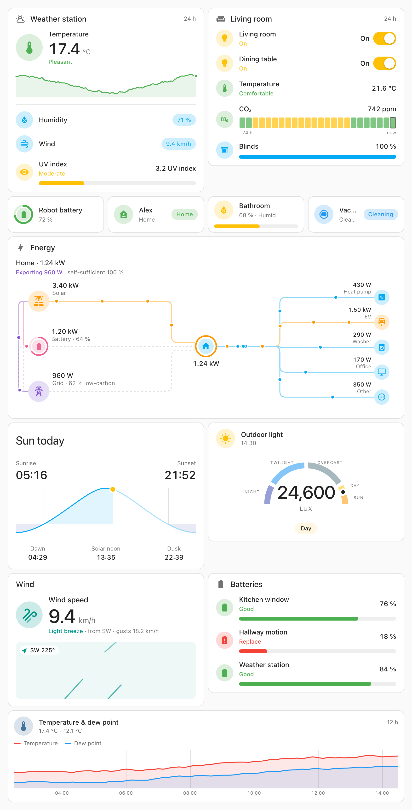

<p align="center">
  
</p>

# Pro Cards

[](https://github.com/malte-wessel/pro-cards/releases)
[](https://hacs.xyz/)
[](https://github.com/malte-wessel/pro-cards/actions/workflows/validate.yml)
[](LICENSE)

**Docs with live examples: https://malte-wessel.github.io/pro-cards/**

Beautiful, customizable cards for Home Assistant dashboards.

Pro Cards are polished dashboard cards that look like they belong in Home Assistant: same spacing, typography and colours, dark mode included. Every detail can be adjusted, from icons, colours and labels driven by values and templates to layouts, graphs and actions. Themes change the look of all cards at once.

- **High quality.** Crisp rendering, sensible defaults, smooth graphs, tested against a real Home Assistant and pixel by pixel in CI.
- **Highly customizable.** Rules switch icon, colour, label and card tint by value or state; templates fill names and values; six layouts, eight visuals, a weather card with forecasts, animated wind and rain cards, a power flow tree, every action Home Assistant offers.
- **Home Assistant design.** The cards use the theme's colours, fonts, radii and state colours, so they blend in with the built-in tile cards, and a custom theme restyles them along with the rest of the dashboard.

<picture>
  <source media="(prefers-color-scheme: dark)" srcset="https://raw.githubusercontent.com/malte-wessel/pro-cards/main/docs/public/readme/cards-dark.png">
  
</picture>

| Card                 | Type                          | What it does                                                                                                                                 | Editor    |
| -------------------- | ----------------------------- | -------------------------------------------------------------------------------------------------------------------------------------------- | --------- |
| Tile Card Pro        | `custom:tile-card-pro`        | One entity as a tile, drawn as its kind: a light's glow and switch, a cover's buttons, a battery's levels, the wind and the rain animated.   | Visual    |
| Poster Card Pro      | `custom:poster-card-pro`      | One entity with one large value, a status, badges and a picture of its own: the weather, the sun, a player's art, a flow behind the card.    | Visual    |
| Tile Group Card Pro  | `custom:tile-group-card-pro`  | Several tiles on one card under a title with badges: a room or a set of devices.                                                             | Visual    |
| Multi Trend Card Pro | `custom:multi-trend-card-pro` | Tile-style trend graph for several sensors with a hover/touch tooltip.                                                                       | Visual    |
| Sun Path Card Pro    | `custom:sun-path-card-pro`    | Today's sun elevation with sunrise, sunset, dawn, noon and dusk.                                                                             | Visual    |
| Sun Azimuth Card Pro | `custom:sun-azimuth-card-pro` | Where the sun is around the house: 3D scene or sky dial, and the sides it shines on today.                                                   | YAML only |
| Weather Card Pro     | `custom:weather-card-pro`     | Current conditions, attributes and the hourly / daily forecast of a weather entity, with rules, sections and templates.                      | YAML only |
| Power Flow Card Pro  | `custom:power-flow-card-pro`  | Solar, battery and grid → home → rooms and devices as a tree with animated flow, the state of the home and its self-sufficiency.             | YAML only |
| Energy Flow Card Pro | `custom:energy-flow-card-pro` | The power flow's tree over a period (today, this week, month or year) from energy meters and their long-term statistics.                     | YAML only |
| Layout Card Pro      | `custom:layout-card-pro`      | Cards inside a section in a grid or masonry, arranged by how many view columns the section spans, as separate cards or one seamless surface. | Visual    |
| Heading Card Pro     | `custom:heading-card-pro`     | A heading with live badges: values, rings, dots, pictures, bars, sparklines, trends and switches, in their kind's colours.                   | YAML only |
| Swipe Card Pro       | `custom:swipe-card-pro`       | Cards side by side in a strip you swipe through, the next one peeking in, with dots; a grid once the section is wide enough.                 | Visual    |

Deprecated in 3.0 and gone in 4.0 ([Moving to 3.0](https://malte-wessel.github.io/pro-cards/guide/migrating)):

| Card                     | Type                              | Use instead                                          |
| ------------------------ | --------------------------------- | ---------------------------------------------------- |
| Entity Card Pro          | `custom:entity-card-pro`          | the tile, or the poster                              |
| Entity Group Card Pro    | `custom:entity-group-card-pro`    | the tile group                                       |
| Entity Sections Card Pro | `custom:entity-sections-card-pro` | a layout card of headings and tile groups            |
| Wind Card Pro            | `custom:wind-card-pro`            | a poster or a tile of the wind kind                  |
| Rain Card Pro            | `custom:rain-card-pro`            | a poster or a tile of the rain kind                  |
| Illuminance Card Pro     | `custom:illuminance-card-pro`     | nothing: it goes (a tile with a strip comes closest) |

All cards support the sections grid (`grid_options`). Requires Home Assistant 2026.4 or newer.

## Installation

### HACS (recommended)

[](https://my.home-assistant.io/redirect/hacs_repository/?owner=malte-wessel&repository=pro-cards&category=plugin)

Or open HACS, search for **Pro Cards**, download it and reload the browser. HACS registers the resource `/hacsfiles/pro-cards/pro-cards.js` automatically.

If HACS does not list it yet, add it as a custom repository first:

1. HACS → three-dot menu → **Custom repositories**.
2. Add `https://github.com/malte-wessel/pro-cards` with category **Dashboard**.
3. Search for **Pro Cards**, download it and reload the browser.

### Manual

1. Copy `dist/pro-cards.js` to `config/www/pro-cards/pro-cards.js`.
2. Settings → Dashboards → three-dot menu → **Resources** → add `/local/pro-cards/pro-cards.js` as **JavaScript module**.
3. Reload the browser. Bump the URL (`?v=2`) after every update to bypass the cache.

## Look and themes

The cards read the Home Assistant theme: card background, text colours, dividers, radii and the named
colour tokens (`primary`, `red`, `amber`, `blue-grey`, ...). Dark mode and custom themes apply without
configuration. Wherever a card accepts a colour you can use a named token, a hex, rgb or hsl value or a
CSS variable. See [Look & themes](https://malte-wessel.github.io/pro-cards/guide/colours).

## The cards

Each card starts with two lines and grows with options. The docs pages take you from the basic example
to the advanced ones step by step.

### Entities

#### Tile Card Pro

One entity as a tile, drawn as its kind: a light brings its switch and glow, a cover its buttons, a thermostat its stepper. Rules pick colour, icon and status by value or state. Visual editor.

```yaml
type: custom:tile-card-pro
entity: sensor.living_room_temperature
visual: { type: sparkline, hours: 12 }
rules:
  - { below: 19, color: blue, icon: mdi:snowflake, status: Cold }
  - { below: 24, color: green, icon: mdi:thermometer, status: Comfortable }
  - { above: 24, color: orange, icon: mdi:sun-thermometer, status: Warm }
```

[Tile Card Pro docs](https://malte-wessel.github.io/pro-cards/cards/tile-card)

#### Poster Card Pro

One entity with one large value, a status badge and badges of its own in the corner. It knows what the entity is and draws it that way: the weather's next hours, the sun's day, a player's art, the wind and the rain animated behind the card. Visual editor.

```yaml
type: custom:poster-card-pro
entity: sensor.wind_speed
visual: { type: flow, variant: lines }
badges:
  - sensor.outdoor_temperature
```

[Poster Card Pro docs](https://malte-wessel.github.io/pro-cards/cards/poster-card)

#### Tile Group Card Pro

Several tiles on one card under a title with badges: a room or a set of devices, as a list or a row. Visual editor.

```yaml
type: custom:tile-group-card-pro
title: Living room
badges:
  - sensor.living_room_temperature
tiles:
  - light.living_room
  - cover.living_room_blinds
  - { entity: media_player.living_room_speaker, name: Music }
```

[Tile Group Card Pro docs](https://malte-wessel.github.io/pro-cards/cards/tile-group-card)

#### Multi Trend Card Pro

Several sensors as smooth lines with a hover tooltip. Visual editor.

```yaml
type: custom:multi-trend-card-pro
entities:
  - { entity: sensor.outdoor_temperature, name: Temperature, color: red }
  - { entity: sensor.dew_point, name: Dew point, color: blue }
```

[Multi Trend Card Pro docs](https://malte-wessel.github.io/pro-cards/cards/multi-trend-card)

### Energy

#### Power Flow Card Pro

Where the electricity comes from and where it goes: solar, battery and grid on the left, the home in the middle, rooms and devices on the right, joined by lines that carry the power as moving dots. The line above says whether the home imports, exports or runs on battery, and how self-sufficient it is.

```yaml
type: custom:power-flow-card-pro
home: sensor.power_consumption
sources:
  - { type: solar, entity: sensor.solar_power }
  - { type: battery, power: sensor.battery_power, soc: sensor.battery_soc }
  - { type: grid, power: sensor.grid_power, price: sensor.electricity_price }
consumers:
  - { entity: sensor.heat_pump_power, name: Heat pump, icon: mdi:heat-pump }
  - { entity: sensor.washer_power, name: Washer, icon: mdi:washing-machine }
```

[Power Flow Card Pro docs](https://malte-wessel.github.io/pro-cards/cards/power-flow-card)

#### Energy Flow Card Pro

Where the energy came from and where it went today, this week, this month or this year: the power flow card's tree, drawn from energy meters and their long-term statistics, with what the grid imported and exported and how self-sufficient the home was.

```yaml
type: custom:energy-flow-card-pro
period: today
sources:
  - { type: solar, entity: sensor.solar_energy }
  - { type: battery, charge: sensor.battery_charge_energy, discharge: sensor.battery_discharge_energy }
  - { type: grid, import: sensor.grid_import_energy, export: sensor.grid_export_energy }
consumers:
  - { entity: sensor.heat_pump_energy, name: Heat pump, icon: mdi:heat-pump }
```

[Energy Flow Card Pro docs](https://malte-wessel.github.io/pro-cards/cards/energy-flow-card)

### Layout

#### Layout Card Pro

Cards, Pro Cards and Home Assistant's own, arranged inside a section in a grid or masonry, as separate cards or one seamless surface. The breakpoints are view columns: the cards can take two columns when the section spans one view column (a phone) and four when it spans two. Each card's `view_layout` sets its span and order, per view columns, and the cards keep their own `visibility`.

```yaml
type: custom:layout-card-pro
columns: 2
breakpoints:
  2: { columns: 4 }
cards:
  - type: custom:weather-card-pro
    entity: weather.home
    view_layout: { span: { 1: full, 2: [2, 2] } }
  - type: tile
    entity: light.kitchen
```

[Layout Card Pro docs](https://malte-wessel.github.io/pro-cards/cards/layout-card)

#### Heading Card Pro

A heading for a room or a part of a view, without a card around it. Its badges are written as a poster's: an icon (a ring, a dot, a picture), a bar, a sparkline or a trend after the value, a switch, rules and their entity's kind colours.

```yaml
type: custom:heading-card-pro
title: Living room
icon: mdi:sofa
badges:
  - sensor.living_room_temperature
  - { entity: sensor.power_consumption, visual: sparkline, format: power }
  - { entity: light.living_room, control: toggle }
```

[Heading Card Pro docs](https://malte-wessel.github.io/pro-cards/cards/heading-card)

#### Swipe Card Pro

Cards, Pro Cards and Home Assistant's own, side by side in a strip you swipe through. It snaps to each card, the next one peeks in, and dots below show the page. Like the layout card's, its options change at breakpoints by view columns: more cards per page, or a grid instead of the strip.

```yaml
type: custom:swipe-card-pro
per_page: 1.15
breakpoints:
  2: { per_page: 2.2 }
  3: { unfold: 4 }
cards:
  - type: custom:tile-card-pro
    entity: sensor.living_room_temperature
    visual: sparkline
  - type: tile
    entity: light.kitchen
```

[Swipe Card Pro docs](https://malte-wessel.github.io/pro-cards/cards/swipe-card)

### Weather

#### Weather Card Pro

A weather entity as a tile, or as sections you compose like the sections card: the hero lead, rows of attributes and entities, trend charts and forecast rows.

```yaml
type: custom:weather-card-pro
entity: weather.home
title: Home
sections:
  - { type: hero }
  - { type: row, entities: [humidity, wind_speed, pressure] }
  - { type: trend, mode: hourly, hours: 12 }
  - { type: forecast, mode: daily, days: 7 }
```

[Weather Card Pro docs](https://malte-wessel.github.io/pro-cards/cards/weather-card)

#### Wind and rain

A wind or a rain sensor is a poster or a tile of the wind or rain kind: the speed or the rate in the kind's colours, the direction and the gusts (or today's total) found on its device, and the animation in the icon or, with `visual: { type: flow }`, behind the whole card.

```yaml
type: custom:poster-card-pro
entity: sensor.rain_rate_roof
visual: { type: flow, variant: drops }
```

[The wind and rain kinds](https://malte-wessel.github.io/pro-cards/cards/poster-types#wind)

#### Sun Path Card Pro

Today's sun elevation with sunrise, sunset, dawn, noon and dusk, computed from your location. Visual editor.

```yaml
type: custom:sun-path-card-pro
title: Sun today
```

[Sun Path Card Pro docs](https://malte-wessel.github.io/pro-cards/cards/sun-path-card)

#### Sun Azimuth Card Pro

Where the sun is around your house: a 3D scene with the house, its shadow and the sky dome, or a sky dial seen from above. On request, sunrise, noon and sunset, and the sides of the house with their sun window today.

```yaml
type: custom:sun-azimuth-card-pro
title: Sun
house:
  front: 20
  sides: { front: Street, back: Garden }
show_sun_times: true
show_sides: true
```

[Sun Azimuth Card Pro docs](https://malte-wessel.github.io/pro-cards/cards/sun-azimuth-card)

### Deprecated

The entity, entity group, entity sections, wind, rain and illuminance cards still work in 3.0 and go in 4.0. Each says so once in the browser console; [Moving to 3.0](https://malte-wessel.github.io/pro-cards/guide/migrating) names what takes over and maps their keys.

## Config schema

`schema/` holds JSON Schemas for every card (`pro-cards.schema.json` accepts any of them). Add `# yaml-language-server: $schema=https://malte-wessel.github.io/pro-cards/schema/pro-cards.schema.json` to a YAML file for completion in editors, or validate with `node scripts/validate.ts card.yaml`.

## Development

```sh
npm install
npm run build       # bundles src/ into dist/pro-cards.js
npm run watch       # rebuild on change
npm run docs:dev    # docs site with live examples at http://localhost:5173/pro-cards/
npm run docs:build  # static site in docs/.vitepress/dist (deployed to GitHub Pages on push to main)
```

`AGENTS.md` lists the project rules; `.claude/skills/` holds step-by-step workflows (docs example, visual case, release).

The docs run the real card sources against a simulated home (`docs/.vitepress/theme/ha-shim/`). To add a live example to a page, wrap a YAML code block in a `::: live` container.

Each card lives as its own TypeScript module in `src/`; `src/index.ts` imports them all. The committed
`dist/pro-cards.js` must match the sources (CI checks this). Releases are cut by pushing a `v*` tag,
which attaches the bundle to a GitHub release.

## Testing

```sh
npm test                 # unit tests (Vitest, happy-dom): pure helpers of every card, the docs' template engine and demo world
npm run test:e2e         # integration tests (Playwright, Chromium): real cards mounted in a browser against the simulated home
npm run test:visual      # visual regression (Playwright in Docker): screenshots compared with tests/visual/__snapshots__
npm run test:visual:update   # re-generate the baselines after an intended visual change
```

Details, the harness API and how to add cases: [tests/README.md](tests/README.md)

Visual baselines are rendered on Linux only, inside `mcr.microsoft.com/playwright`, so the same pixels are compared locally and in CI. Docker Desktop must be running for the two visual commands. The browser tests use `tests/harness/`, a tiny Vite page that loads the card sources and the docs' Home Assistant shim; the clock is frozen at 21 June 2026, 12:00 Europe/Berlin.

## License

MIT
