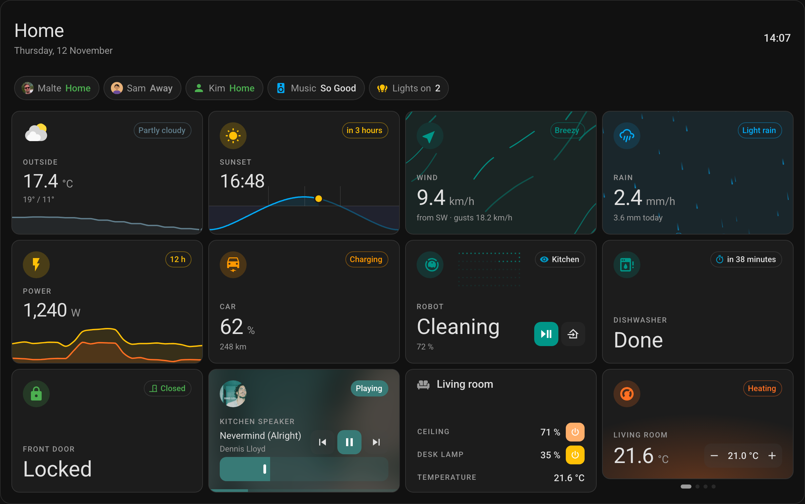
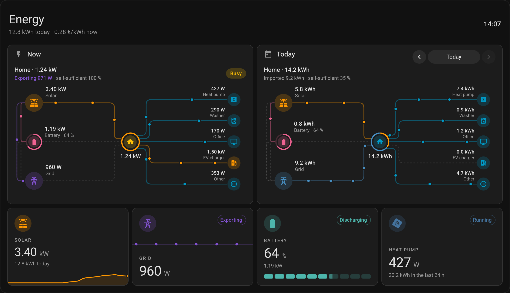
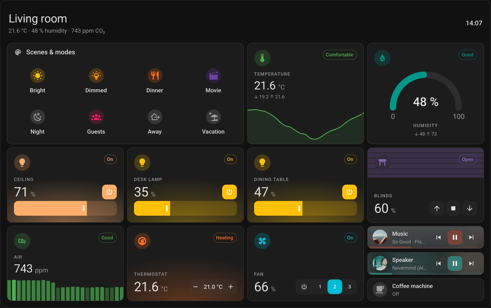
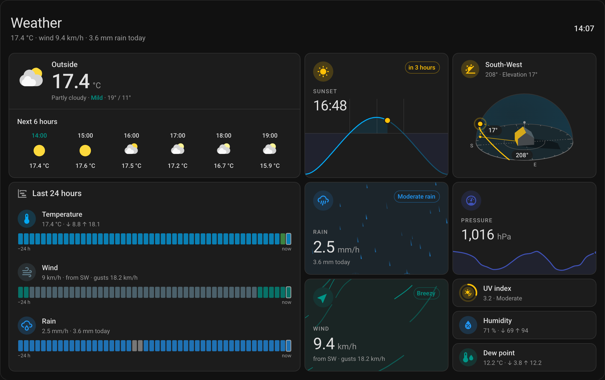

<p align="center">
  
</p>

# Pro Cards

[](https://github.com/malte-wessel/pro-cards/releases)
[](https://hacs.xyz/)
[](https://github.com/malte-wessel/pro-cards/actions/workflows/validate.yml)
[](LICENSE)

Dashboard cards that look like they belong in Home Assistant: tiles, posters and tile groups for every kind of entity, power and energy flows, weather, headings, layouts and more. One bundle, no dependencies, styled by your theme, in 12 languages.

**[Docs with live examples](https://malte-wessel.github.io/pro-cards/)** · [Playground](https://malte-wessel.github.io/pro-cards/playground) · [Showcase](https://malte-wessel.github.io/pro-cards/showcase/home)



<p>
  
  
</p>



## Why Pro Cards

- **Knows your entities.** A tile or a poster recognises what an entity is (a light, a thermostat, a cover, a battery, the weather, a car, a washer …) and brings its icon, colours, status, controls and picture.
- **Controls on the card.** Switches, sliders, steppers, segments, selects and buttons for every domain, without opening a dialog.
- **Made to fit in.** Home Assistant's spacing, type, colours and dark mode; custom themes restyle the cards with the rest of your dashboard.
- **Rules and templates.** Change the colour, icon, status or picture by a value or a state; fill any text with a template.
- **Visual editors** for every card, and a [Playground](https://malte-wessel.github.io/pro-cards/playground) to try them.

## Cards

| Card        | Type                          | What it does                                                                        |
| ----------- | ----------------------------- | ----------------------------------------------------------------------------------- |
| Tile        | `custom:tile-card-pro`        | One entity as a compact tile, drawn as its kind, with its controls.                 |
| Poster      | `custom:poster-card-pro`      | One entity large: a light's glow, a player's art, the wind and rain as live fields. |
| Tile group  | `custom:tile-group-card-pro`  | Several tiles under one header, as a list, a row or a table.                        |
| Heading     | `custom:heading-card-pro`     | A heading with a subtitle and live badges.                                          |
| Power flow  | `custom:power-flow-card-pro`  | Solar, battery and grid into the home and out to rooms and devices, animated.       |
| Energy flow | `custom:energy-flow-card-pro` | The same tree over a day, week, month or year from the energy statistics.           |
| Weather     | `custom:weather-card-pro`     | The current weather with an hourly or daily forecast, as a tile or in sections.     |
| Multi trend | `custom:multi-trend-card-pro` | Several sensors over time in one graph.                                             |
| Sun path    | `custom:sun-path-card-pro`    | Today's sun elevation with sunrise, sunset, dawn, noon and dusk.                    |
| Sun azimuth | `custom:sun-azimuth-card-pro` | Where the sun is around your house, and the sides it shines on.                     |
| Layout      | `custom:layout-card-pro`      | Cards in a grid or masonry inside a section, rearranged by its width.               |
| Swipe       | `custom:swipe-card-pro`       | Cards in a strip you swipe through.                                                 |

The entity, entity group, entity sections, wind, rain and illuminance cards are deprecated and go in 4.0; [Moving to 3.0](https://malte-wessel.github.io/pro-cards/guide/migrating) maps them to the new cards.

## Installation

Requires Home Assistant 2026.4 or newer.

### ~~HACS~~ Marketplace

Since Home Assistant 2026.11, HACS is part of Home Assistant as the Marketplace; before 2026.11 the same steps work in HACS.

[](https://my.home-assistant.io/redirect/hacs_repository/?owner=malte-wessel&repository=pro-cards&category=plugin)

Or go to **Settings → Marketplace**, search for **Pro Cards**, install it and reload the browser. Not listed yet? **Settings → Marketplace → Add from link**, `malte-wessel/pro-cards` (in HACS: **Custom repositories**, category **Dashboard**).

### Manual

1. Download `pro-cards.js` from the [latest release](https://github.com/malte-wessel/pro-cards/releases) to `config/www/pro-cards/pro-cards.js`.
2. **Settings → Dashboards → ⋮ → Resources**: add `/local/pro-cards/pro-cards.js` as a JavaScript module.
3. Reload the browser; after an update, add `?v=2` (and so on) to the resource URL.

Then add a card from the card picker ("Tile Card Pro", "Poster Card Pro" …) or follow [Install & first card](https://malte-wessel.github.io/pro-cards/guide/getting-started).

## YAML completion

Every card has a JSON Schema. Add this line to a YAML file for completion and checks in your editor:

```yaml
# yaml-language-server: $schema=https://malte-wessel.github.io/pro-cards/schema/pro-cards.schema.json
```

## Development

```sh
npm install
npm run docs:dev   # the docs with live examples, at http://localhost:5173/pro-cards/
npm run build      # bundles src/ into dist/pro-cards.js (committed; CI checks it)
npm run check      # format, lint, types, build, unit, integration and docs tests
npm run ha         # a real Home Assistant with the bundle, at http://localhost:8123
```

[AGENTS.md](AGENTS.md) has the project's rules, [tests/README.md](tests/README.md) the tests. Releases are `v*` tags; the workflow attaches the bundle.

## License

MIT
